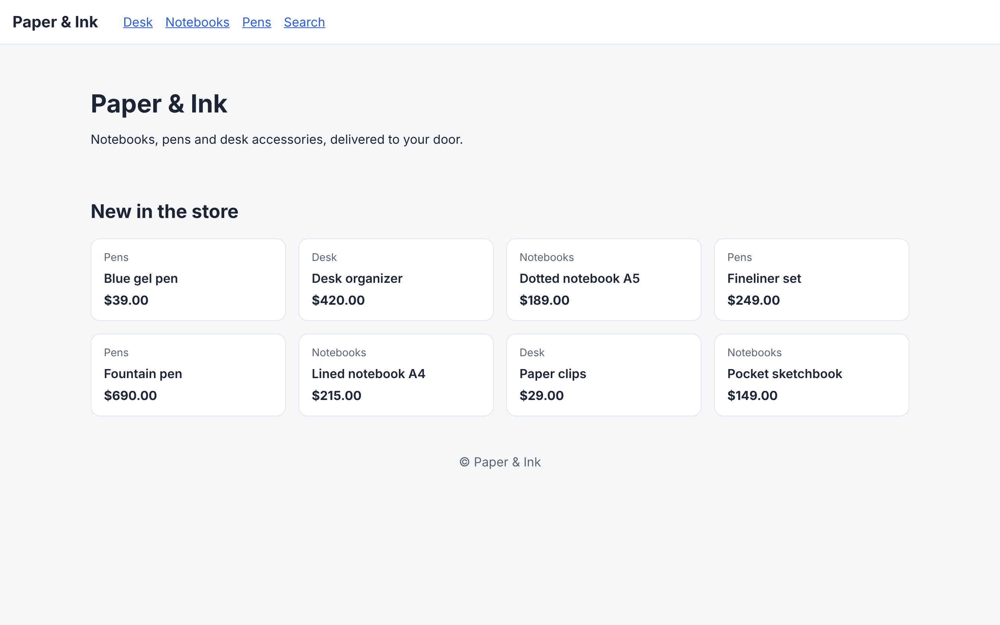
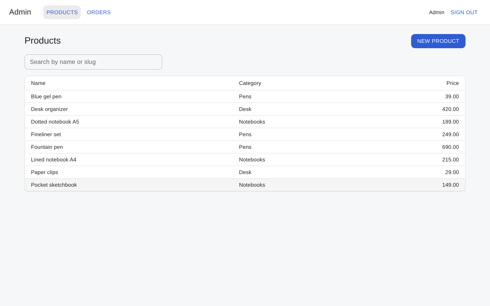
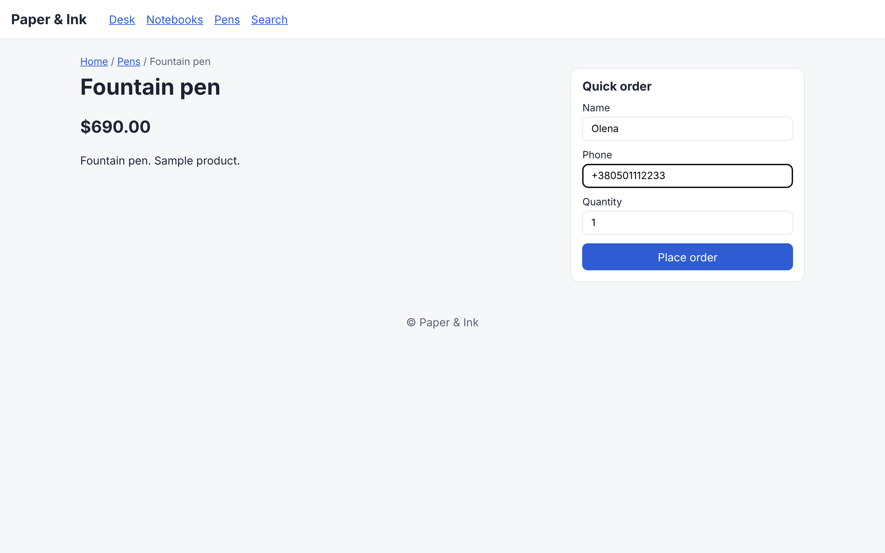
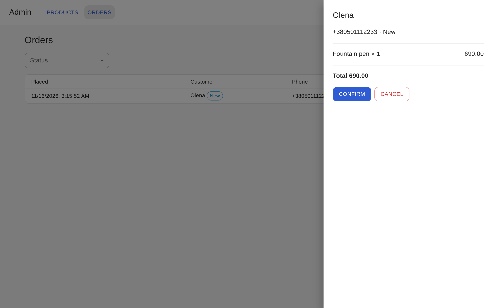

# Fullstack Modular Template

[](https://github.com/Weretik/fullstack-modular-template/actions/workflows/backend.yml)
[](https://github.com/Weretik/fullstack-modular-template/actions/workflows/frontend.yml)
[](LICENSE)

**Stack:** .NET 10 · ASP.NET Core · EF Core · PostgreSQL · React · Next.js · TypeScript · Nx · Material UI

A starter for a full-stack product built as a **modular monolith**: a .NET 10 API with PostgreSQL, a
search-engine-friendly Next.js storefront, and a React admin app. It shows the structure I use for real projects in a
small example domain, so a new project starts from working code and clear rules instead of an empty folder.

The example is a small stationery shop:

- **Identity**: staff sign in with a cookie session; roles `Admin` and `Manager`.
- **Catalog**: staff manage categories and products; the public site lists, searches and shows them.
- **Orders**: visitors place an order from the site (safe to retry); staff confirm, complete or cancel it.

| Storefront (Next.js) | Admin (React) |
| --- | --- |
|  |  |
|  |  |

## What is inside

```
backend/     .NET 10 modular monolith, PostgreSQL, tests, OpenAPI document generated from the code
frontend/    Nx workspace: Next.js storefront (apps/site), React admin (apps/admin), typed API client
docs/        Screenshots used by this README
.github/     Two CI workflows, each runs only when its half of the repository changes; weekly Dependabot updates
```

`backend/` and `frontend/` know nothing about each other except one file: the OpenAPI document
`backend/docs/contracts/openapi.json`. Each half has its own README, decisions (ADRs) and CI, so either one can move
to its own repository (see [Splitting into two repositories](#splitting-into-two-repositories)).

| | Backend | Frontend |
| --- | --- | --- |
| Start here | [backend/README.md](backend/README.md) | [frontend/README.md](frontend/README.md) |
| Architecture | [Modules, layers, rules](backend/docs/architecture/README.md), [C4 diagrams](backend/docs/architecture/c4.md) | [Apps and libraries](frontend/docs/architecture.md) |
| Decisions | [Backend ADRs](backend/docs/decisions/README.md) | [Frontend ADRs](frontend/docs/decisions/README.md) |
| Rules | [Backend rules](backend/docs/rules.md) | [Frontend rules](frontend/docs/rules.md) |

## Main ideas

- **Modules, not layers, are the top-level split.** Each module (`Identity`, `Catalog`, `Orders`) owns its data in
  its own PostgreSQL schema and is made of five projects: `Api`, `Application`, `Domain`, `Infrastructure`,
  `Contracts`. A module talks to another one only through that module's `Contracts`.
- **One folder per use case** (`Features/Products/Commands/CreateProduct/`): command, validator and handler sit
  together, so a change touches one place.
- **Business rules return results, not exceptions.** A handler returns `Result<T>` with a typed `Error`; one
  translation turns it into an RFC 9457 problem response.
- **Reliable side effects.** A message to another part of the system is saved in an outbox table in the same
  transaction and delivered by a scheduled tick, so a crash never loses or doubles it.
- **Safe retries.** Placing an order takes an `Idempotency-Key`; a repeat returns the first order.
- **The contract comes from the code.** Every build regenerates the OpenAPI document; the frontend generates its
  TypeScript client from it, and CI fails when either side is out of date.
- **Rules are tested, not only written.** Architecture tests check module boundaries, layer dependencies and folder
  rules on every build.

## Quick start

You need the .NET 10 SDK, Node.js 22 with npm 11, and Docker.

```bash
# 1. Database
cd backend
docker compose up -d

# 2. API on http://localhost:5000 (Swagger UI at /swagger); creates the schema and sample data on first start
dotnet run --project src/Host/Host.Api

# 3. Frontend (in a second terminal)
cd frontend
npm ci
npx nx dev site      # storefront on http://localhost:3000
npx nx serve admin   # admin on http://localhost:4200
```

Sign in to the admin app as `admin@example.com` with the password `ChangeMe123!`. These development-only values live
in `backend/src/Host/Host.Api/appsettings.Development.json`; change them before you share a running copy.

## Starting a new project from this template

1. Create a repository from this one (or copy it) and rename the solution and namespaces you want to keep.
2. Replace the example modules with your own: add a module the way
   [backend/README.md](backend/README.md#add-a-module) describes, then delete the ones you do not need.
3. Rebuild the backend, run `npm run contracts:generate` in `frontend/`, and build your screens on the generated
   client.
4. Write a decision record for every lasting choice you make on the way (a new module, an external system, hosting).

## Branch names

Every feature or fix is a new branch from `main` named by Conventional Branch: `<type>/<short-kebab-description>`,
in English, 3 to 6 words in the description, with the type `feat`, `fix`, `hotfix`, `refactor`, `perf`, `docs`,
`test` or `chore`, for example `feat/order-history-export` or `fix/login-redirect-loop`. A feature that spans several
repositories uses the same branch name in each. No random suffixes, hashes or dates; `dependabot/*` and `renovate/*`
branches are allowed. The workflow [Branch name](.github/workflows/branch-name.yml) fails a pull request whose branch
breaks the rule; mark its check `branch name` as required in the repository rules so such a branch cannot merge.

## Deploying

The API runs behind a reverse proxy or load balancer that ends TLS. Before the first deploy read
[Deploy behind a reverse proxy](backend/README.md#deploy-behind-a-reverse-proxy): forwarded headers, HTTPS and HSTS,
cookies and CORS, migrations as a separate step, secrets, health checks and rate limits. The frontend build settings
are in [frontend/README.md](frontend/README.md#environment-variables).

## Splitting into two repositories

Nothing outside `backend/` refers to the frontend and nothing in `frontend/` builds the backend, so the split is a
move, not a rewrite:

1. Move `backend/` to the root of a new repository together with `.github/workflows/backend.yml`, and drop the
   `backend/` prefix from the workflow's paths and working directory.
2. Do the same for `frontend/` with `frontend.yml`.
3. In the frontend, point `contracts:generate` at the backend's published `openapi.json` (for example the raw file
   from the backend's main branch) instead of `../backend/docs/contracts/openapi.json`.

## Author

Built by [Vitaliy Tsiupin](https://www.linkedin.com/in/vitaliythupin/), full-stack .NET + React developer.
The same structure runs in production systems I build for clients.

## License

[MIT](LICENSE)
