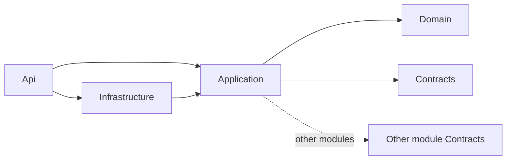

# Architecture

The backend is a **modular monolith**: one process, one database, several modules that keep to themselves. Each
module could become its own service later (see the backend README), but until there is a reason to, one process
is cheaper and simpler.

## Modules

| Module | Owns | Schema | Public surface |
| --- | --- | --- | --- |
| Identity | Staff accounts, roles, the cookie session | `identity` | `IdentityPolicies.Staff`, `ICurrentUser` |
| Catalog | Categories and products, public catalog reads, sitemap | `catalog` | `ICatalogProductReader` |
| Orders | Orders, their lines and status, the order-placed notification | `orders` | `OrderPlaced` message |

`Orders` uses `Catalog.Contracts` to read the current name and price of the products in an order, and
`Identity.Contracts` to protect its admin endpoints. Nothing else crosses a module boundary.

## Projects inside a module

| Project | Holds | May reference |
| --- | --- | --- |
| `Domain` | Aggregates, value objects, domain errors. No EF, no ASP.NET. | `BuildingBlocks.Domain` |
| `Application` | One folder per use case (command or query, validator, handler), ports such as `ICatalogDbContext` | own `Domain`, own `Contracts`, other modules' `Contracts`, `BuildingBlocks.Application` |
| `Infrastructure` | EF Core `DbContext`, configurations, migrations, seeding, adapters | own `Application`, `BuildingBlocks.Infrastructure` |
| `Api` | Minimal API endpoints and the module entry class `<Name>Module` | own `Application` and `Infrastructure`, `BuildingBlocks.Api`, other modules' `Contracts` |
| `Contracts` | What other modules may use: interfaces, DTOs, messages | nothing from other modules |

`Host.Api` only composes: it calls `Add<Name>Module` / `Map<Name>Module` for each module and sets up middleware,
OpenAPI and the outbox tick endpoint. It contains no business logic.

## Building blocks

| Project | Purpose |
| --- | --- |
| `BuildingBlocks.Domain` | `Result`, `Result<T>`, `Error`, `ErrorType`, `Entity<TId>`, `IAggregateRoot` |
| `BuildingBlocks.Application` | Validation and logging pipeline, paging and search helpers, outbox handler interface |
| `BuildingBlocks.Infrastructure` | `ModuleDbContext` (schema per module, unique-violation translation), outbox storage and dispatch |
| `BuildingBlocks.Api` | Error-to-problem mapping, global exception handler, outbox tick endpoint |

Building blocks know nothing about any module. Something enters them only when at least three places need it.

## A request, end to end

`POST /api/admin/catalog/products`:

1. The endpoint in `Catalog.Api/Endpoints/Products/CreateProductEndpoint.cs` binds its own `Request` record and
   sends a `CreateProductCommand` through Mediator.
2. The pipeline logs the request and runs `CreateProductValidator`. Invalid input stops here with a 400 problem
   listing the fields.
3. `CreateProductHandler` checks the category, asks `Product.Create` to apply the domain rules, adds the product,
   and saves once. A rule failure returns a typed error; a duplicate slug, even from a racing request, returns
   `409`.
4. The endpoint turns the result into `201 Created` or a problem response.

## Data

- One PostgreSQL database, one schema per module, one migration history table per schema.
- No foreign keys between schemas; a module stores another module's ids as plain values.
- Reads use projections or `AsNoTracking` and page in SQL; there are no queries inside loops.
- Search splits the input into words, each an escaped `LIKE` on a lower-cased column with a
  `pg_trgm` index.
- Shared state has an explicit race guard: unique indexes for slugs and idempotency keys, a row version (`xmin`)
  on orders, a conditional `UPDATE` to claim outbox messages.

## Security

- Staff sign in with ASP.NET Core Identity and get an HttpOnly, Secure, `SameSite=Strict` cookie. The API answers
  401 or 403 instead of redirecting.
- Admin endpoints require the `staff` policy (role `Admin` or `Manager`); public endpoints are explicitly anonymous.
- Five failed sign-ins lock an account for a while; passwords have at least ten characters.
- The outbox tick endpoint needs a shared key, compared in constant time, and is hidden from the OpenAPI document.
