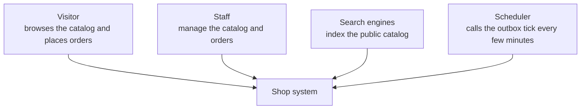
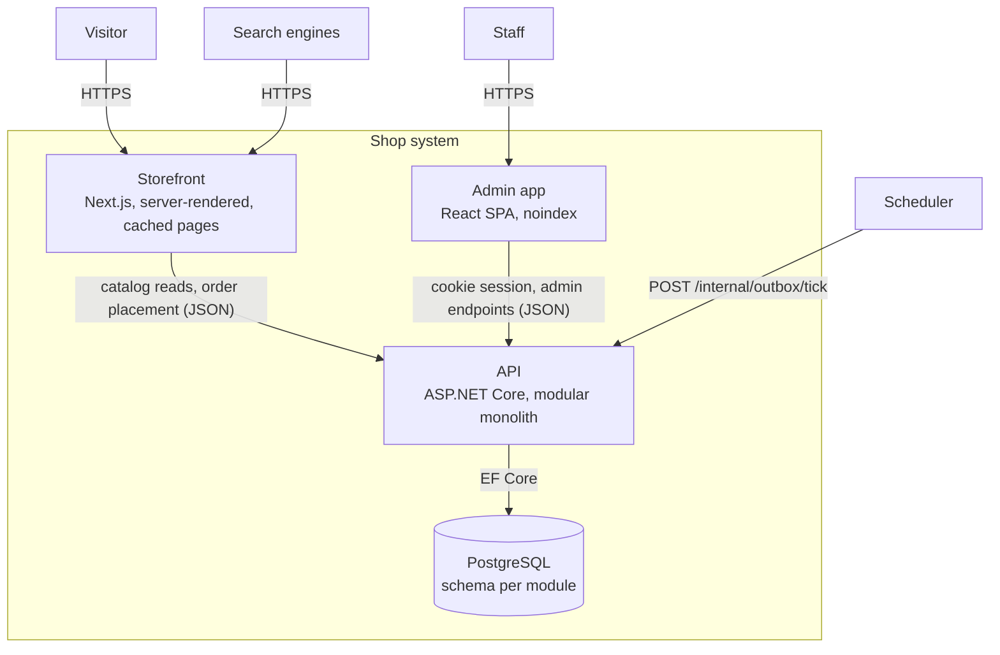
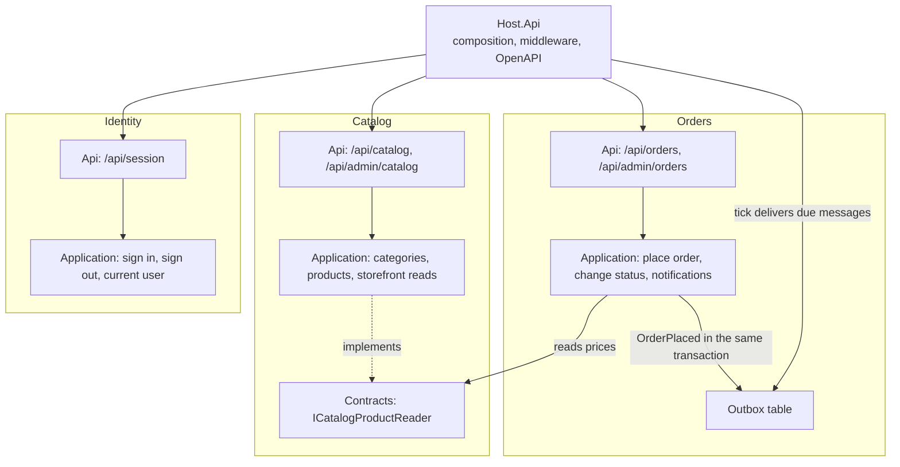

# C4 diagrams

Three levels: who uses the system, which deployable parts it has, and how the API is split inside.

## Context

## Containers

## Components of the API

Update these diagrams in the same change that adds a module, an external system, or a new way of running work.
