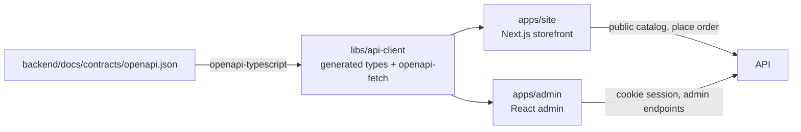

# Frontend architecture



The apps never import from each other. Both depend on `@template/api-client`, which is the only place that knows
how to talk to the API.

## API client (`libs/api-client`)

- `generated/api.ts`: types generated from the backend contract. Never edited by hand.
- `createApiClient({ baseUrl, fetch })`: an `openapi-fetch` client that sends cookies.
- `apiCall(request)`: unwraps a response or throws `ApiError` with the HTTP status, the problem `code` and field
  errors keyed by camelCase field name, ready for a form.
- `newIdempotencyKey()`: a key for requests that must not run twice.
- `Schema<'ProductResponse'>`: a named schema type, so components can type their props from the contract.

## Storefront (`apps/site`)

```
src/
  app/          routes only: home, /catalog/[category], /products/[slug], /search, sitemap.ts, robots.ts
  features/
    catalog/    data/ (reads, paging), seo/ (JSON-LD), ui/ (cards, grid, pagination, breadcrumbs, category nav)
    orders/     quick order form (client component) and its request
  platform/     site settings, API clients for server and browser, price formatting
```

- Pages are server components. Catalog reads are cached for five minutes and refreshed in the background, so the
  API sees a few requests per page per period.
- Every page has a title, description and canonical URL. Category pages with `?page=2` canonicalize to themselves;
  internal search answers `noindex, follow`.
- Product pages emit `Product` and `BreadcrumbList` JSON-LD. The sitemap lists the home page, categories and
  published products from one API call.
- Only `SITE_ENV=production` is indexable; previews and staging answer `noindex` and `robots.txt` disallows all.
- An unknown product or category returns a real 404.
- The only client component is the quick order form; it uses an idempotency key and a pending lock.

## Admin (`apps/admin`)

```
src/
  app/          layout, routes, providers (theme, React Query, router)
  features/
    session/    sign-in page, the guard that sends signed-out users to it
    products/   list with search and paging, right-side editor drawer
    orders/     list with status filter, order panel with status actions
  platform/     API client and query client
```

- Server state lives in React Query; mutations invalidate the lists they change.
- Signing in sets an HttpOnly cookie on the API; the app only asks `GET /api/session` who is signed in.
- In development Vite proxies `/api` to the backend, so the cookie stays on the admin origin.
- `index.html` has `noindex` and `robots.txt` disallows everything.
- Lists show only problems (for example a draft product or a new order), not "all good" badges.
- Editing happens in a drawer on the right; validation errors from the API appear on the matching fields.
